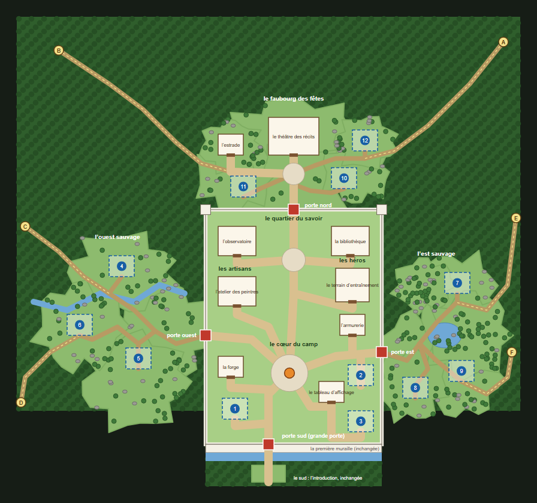

# Le plan d'agrandissement du camp (v4, validé par le propriétaire le 22 oct, codé dans le jeu en local)

**En une phrase :** la muraille reste carrée et le camp grandit vers le nord, rangé en quartiers ; dehors, à l'ouest, à l'est et au nord, trois clairières sauvages, séparées par la forêt, accueillent les prochains bâtiments et les départs des prochaines missions ; le sud, l'introduction du jeu, ne change pas.

## Ce qui ne bouge pas
- **La première muraille et la grande porte du sud**, telles qu'elles : 42 cases, douves, pont-levis, porte sur les colonnes 14 et 15.
- **Le sud, l'introduction :** la route du pont, la forêt de chaque côté et les limites de la carte. La carte a la forme d'une clé : large au nord, une queue étroite au sud. **De la route du pont, on n'atteint ni l'ouest, ni l'est, ni le nord** : il faut traverser le camp et sortir par sa porte (vérifié dans `?test`).
- **Le repère :** l'origine est celle d'avant (la première muraille de x 0 à 42, son mur à y 31). Le camp monte donc dans les y négatifs (le mur nord est à y = -25), et le monde va de x -46 à 76 et de y -72 à 38.

## Les murs et les portes
La muraille est **carrée** : les murs ouest et est sont droits et plus longs (la toile des pièces est refaite par `design/camp/outils/murs_jeu.py`), le mur nord est 25 cases plus haut, avec des tours d'angle carrées. **Trois portes secondaires** (ouest, est, nord), toujours ouvertes, finies ou non : ce sont celles du chantier de Mope. Les murs montent toujours avec les missions de l'axe camp.

## Les quartiers
| Quartier | Ce qu'il y a |
|---|---|
| **le cœur du camp** | la place du village et son feu, le tableau d'affichage, la boîte aux lettres, le barde ; la sentinelle à l'entrée |
| **le quartier du savoir** (au nord) | l'observatoire (la table des cartes), la bibliothèque (les archives, la tente d'aujourd'hui), autour de la place du savoir |
| **les artisans** (à l'ouest) | l'atelier, la forge |
| **les héros** (à l'est) | le terrain d'entraînement, l'armurerie |
| **le faubourg des fêtes** (hors les murs, au nord, devant la porte nord) | le théâtre des récits et l'estrade, autour de la place des fêtes |

## Dehors : trois clairières sauvages
Chacune a sa silhouette (des lobes qui se recouvrent) et **trois emplacements** pour les prochains bâtiments (6 × 5 cases) ; le camp en a trois aussi. Des sentiers de terre, étroits et sinueux (pas de pavés : c'est plus sauvage que dans le camp), partent des portes et **s'enfoncent dans la forêt** (A à F) : les départs des prochaines missions.

| Clairière | Ce qu'on y trouve |
|---|---|
| **l'ouest** | un ruisseau, un campement de chasseur (sa tente, son feu qui fume, ses bûches, son étendoir), des lapins |
| **l'est** | un étang (des canards, des roseaux, des nénuphars), une ferme (des meules, une charrette, un épouvantail, un potager, des ruches et leurs abeilles) |
| **le nord** | le faubourg des fêtes : la place des fêtes, ses étals rayés, ses lanternes, son puits, ses bancs, ses massifs de fleurs |

**Le décor vit :** des buissons (à baies, en fleurs), des fougères, des herbes hautes, des champignons, des rochers, des troncs couchés, des fleurs qui changent de couleur, des arbres isolés ; l'eau scintille et fait des ronds ; les papillons volent au-dessus des fleurs, les oiseaux traversent le ciel, le pollen (ou les feuilles à l'automne) dérive ; la nuit, des lucioles sortent dans les clairières et chaque lanterne a sa lumière.

## Comment c'est fait
- `design/camp/plans/plan_agrandi.py` dessine le plan, le vérifie (aucun chevauchement, rien qui traverse un lieu, un mur hors d'une porte, tout relié à la place du village, le sud fermé) et écrit `src/data/plan.json` (`python plan_agrandi.py --jeu`).
- `src/01_plan.js` lit ce fichier : les lieux, les sentiers, les clairières, la forêt (tout ce qui n'est pas libre est bois, avec des arbres de plus en plus clairsemés), le sol (`terre`).
- `src/53_sauvage.js` : le sol du dehors, les pièces dessinées pour le jeu, le décor des clairières et du camp. `src/54_vivant.js` : ce qui bouge.
- Le monde est plus grand : la collision (`05_collision.js`) range les obstacles par paquets et cherche ses chemins dans un tas binaire ; les habitants du camp n'en regardent qu'un peu (leur recherche renonce si la cible est trop loin).

## À décider, puis à faire
- **Ce qui fait grandir les archives**, et leur bibliothèque (le design est validé, le jeu n'a encore que la tente).
- **Les lieux agrandis dans le jeu** : le théâtre, l'observatoire, la halle de l'atelier, la bibliothèque (design validé le 19 oct) ; pour l'instant, leurs emplacements sont des piquets et une pancarte.
- La vue visite (la carte du dashboard) ne montre que le camp ; les clairières n'y sont pas.
