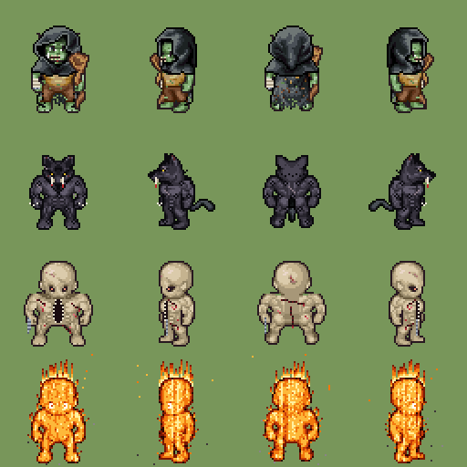
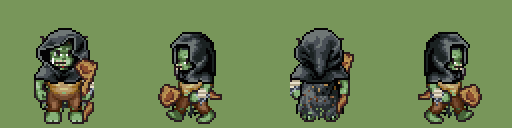
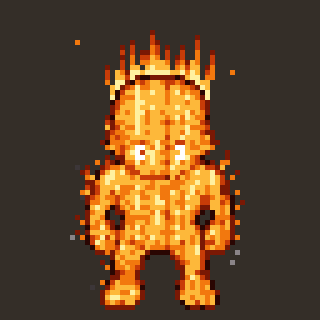

# Mope, l'ancien changepeau

La classe de Mope (DevMope). Design validé par Mope le 23 oct. 2026 (« je valide tout »). La fiche qui entre dans le jeu : `content/classes/changepeau.json`.

Un vieil orc vagabond qui porte trois bêtes sous la peau : il commence faible, se nourrit des coups, puis mue dans la forme que la salle demande. Inspiré de l'Abomination de Darkest Dungeon, avec trois formes au lieu d'une ; de Baldur's Gate 3, les PV de forme et la chute ; de XCOM 2, le coup puis le repli et l'aide à distance d'un allié.

## Avant la mue : l'orc
- **Rôle :** dégâts, avec la particularité « change de façon de se battre selon la salle ». Aucune forme ne copie un rôle de l'équipe (Baba tank, Shadow dégâts, le Traqueur contrôle) : chaque forme mélange deux choses, et toutes frappent.
- **Caractéristiques (27 points) :** FOR 14, DEX 10, CON 14, INT 8, SAG 14, CHA 12. FOR pour la Bête et la Cosa, SAG pour l'Illuminé, CON pour tenir.
- **PV de base 110, déplacement 5 cases, Rage** (+10 par coup donné ou reçu, 50 au plus). La Rage ne sert qu'à muer.
- **Bâton noué** (attaque de base, contact, 8 + d4 + FOR) et **La Mue** (action bonus, 20 Rage).

## La mue
1. **Muer** coûte 20 Rage et l'action bonus. Il choisit la Bête, la Cosa ou l'Illuminé selon la salle.
2. **Les PV de la forme** : chaque forme a sa propre barre (Bête 40, Cosa 60, Illuminé 30). Les coups la vident d'abord ; ses PV d'orc restent intacts dessous.
3. **La chute** (la faiblesse de la classe) : à 0 PV de forme, il redevient orc, À terre et Exposé ; les dégâts en trop passent sur ses PV d'orc.
4. **Remuer** : redevenu orc, la même forme coûte 20 Rage, une autre 30. Il peut aussi quitter sa forme de lui-même (action bonus), sans tomber.

En forme, son attaque de base et ses capacités sont celles de la forme.

| | La Bête | La Cosa | L'Illuminé |
|---|---|---|---|
| Mélange | dégâts + mobilité | dégâts + résistance | dégâts de zone + un coup de main |
| PV de la forme | 40 | 60 | 30 |
| Attaque de base | Crocs : contact, 8 + d4 + FOR | Poing de chair : contact, 8 + d4 + FOR | Braise : 7,5 m, 8 + d4 + SAG |
| Première capacité | Bond (action bonus) : saute sur une cible à 7,5 m, elle est À terre | Étreinte (action bonus) : attire un ennemi de 3 m jusqu'à son contact | Embrasement (action) : petite zone de Feu à 7,5 m, ceux dedans sont Brûlants |
| Deuxième capacité | Curée (action) : 14 + d6 + FOR, ×2 sur À terre ou Exposé, puis recule de 2 cases sans riposte | Dévorer (action) : un ennemi À terre ou attiré, 14 + d6 + FOR, ses PV de forme regagnent la moitié | Armes ardentes (action bonus) : l'arme d'un allié brûle 2 tours, ses coups rendent Brûlant et allument l'Huile |
| Faiblesse de la forme | Brûlant ou dans le Feu, il ne peut plus bondir | sa chair huileuse : le feu lui fait ×2 | Trempé ou dans l'Eau, il s'éteint et perd sa forme |
| Points de classe | 9 / 10 | 9 / 10 | 8 / 10 |

Pas de foudre ni d'eau : c'est la Mage.

## Ce qui sort du cadre
Le cadre prévoit 3 capacités par classe ; le changepeau en a 2 + 3 kits de forme. L'armurerie le marque donc « hors cadre » pour l'instant. C'est proposé au groupe dans une issue « Idée » : une classe à formes, où chaque forme est un kit de 10 points de classe avec sa propre barre de PV. Chaque forme, seule, tient dans les 10 points (en comptant les PV de base et la Mue).

## Le look
| Forme | Planche | Ce qu'on voit |
|---|---|---|
| L'orc | `public/assets/lpc/entrainement/changepeau.png` (toutes les animations), `formes/orc.png` | grand, maigre et musclé, peau vert pâle, capuche et cape usées, t-shirt en lambeaux, pantalon troué, long bâton noueux ; l'avant-bras gauche bandé et enchaîné, la bouche cousue |
| La Bête | `formes/bete.png` | un tigre à dents de sabre debout et voûté, noir à taches de jaguar, poil long comme un loup, cicatrices, griffes, échine hérissée, crocs qui gouttent de sang |
| La Cosa | `formes/cosa.png` | une montagne de chair crue, peau tendue et déchirée, coutures qui saignent, une mâchoire jusqu'au ventre, des chaînes au bras |
| L'Illuminé | `formes/illumine.png`, `formes/illumine-bleu.png` | un corps tout entier de flammes, yeux blancs brûlants, cendres qui tombent ; bleu vif quand il attaque |

 

Au camp, Mope l'incarne en orc dans son onglet. Au terrain d'entraînement, chaque forme a sa planche animée (toutes les poses LPC) : ses bras et son corps bougent quand elle frappe, lance ou bondit.

## Les animations et les ultimes (validés par Mope le 24 oct. 2026)
- **Les mues :** la Bête, l'orc plié de douleur, le poil qui jaillit, le rugissement ; la Cosa, bras écartés, la chair qui gonfle et les coutures qui craquent ; l'Illuminé, bras levés, une colonne de flammes.
- **La Braise (12 m) :** le bras se tend, l'énergie converge dans la paume, une boule de feu bleu grossit, part avec une longue traînée, et explose (éclair blanc, langues bleues, onde, feu orange). **L'Embrasement** porte à 9 m.
- **L'Étreinte :** des tentacules de chair cousue jaillissent, saisissent, tirent : l'ennemi est **Enserré** (il ne bouge plus jusqu'à la fin de son prochain tour).
- **Dévorer :** la Cosa arrache un bras, la gueule de sa panse le mange : l'ennemi est **Mutilé** (désavantage à ses attaques, tout le combat).
- **La Bête :** le Bond (accroupie, les pieds devant, en cloche), la Curée (trois vrais coups de griffes, puis le saut en arrière), les Crocs (la mâchoire qui se referme).
- **Les trois ultimes (une fois par combat chacun, une action) :**
  - **La Grande Chasse (la Bête) :** de proie en proie, jusqu'à 3 ennemis à 9 m l'un de l'autre, 14 + d6 + 2 chaque morsure, la dernière À terre, sans attaque d'opportunité ; une traînée d'ombre rouge.
  - **Le Festin (la Cosa) :** tous les ennemis à 4,5 m tirés à son contact, Enserrés ; la gueule dévore le plus blessé (18 + d8 + 2) ; ses PV de forme regagnent tous ces dégâts.
  - **Le Soleil noir (l'Illuminé) :** il s'élève les deux bras levés (le soleil noir grossit au-dessus de ses mains), puis plonge comme Superman, un bras devant lui, jusqu'à 12 m : une zone de 4,5 m, 18 + d8 + 2 et la Brûlure aux ennemis ; le sol reste en feu (il brûle tout le monde) ; ses alliés ne prennent pas l'explosion.

Les maquettes validées : la page « Formes du changepeau ». Les photos en jeu : `captures/terrain-*.png`.

## Refaire les images
- `python3 design/classes/changepeau/outil/orc.py` : la planche de l'orc et ses crédits. Les pièces du générateur LPC sont lues depuis son dépôt GitHub et gardées dans `dl/` ; les retouches suivent la tête et les manchettes image par image (skill lpc-sprite-mods).
- `python3 design/classes/changepeau/outil/maquettes/planches_jeu.py` : les planches animées des formes pour le jeu (`public/assets/lpc/entrainement/formes/*-anim.png`), dans toutes les poses LPC (`poses.py` recale les retouches sur la tête, image par image).
- `python3 design/classes/changepeau/outil/effets.py` : les 19 effets (`public/assets/lpc/effets/changepeau/`) et leur liste, `src/entrainement/effets-changepeau.json` ; `icones_ultimes.py` : les enseignes des trois ultimes.
- `npm run build && node tools/capture-changepeau-terrain.mjs` : les photos en jeu.
- `outil/maquettes/` : les scripts des planches des formes (ils lisent les pièces rangées par nom de calque dans un dossier `lpc/` à côté d'eux, et les palettes du générateur).

## Sous-classes (idées, à écrire)
- **Maître des peaux :** change de forme moins cher.
- **L'Engloutisseur :** garde une seule forme, mais plus forte.
